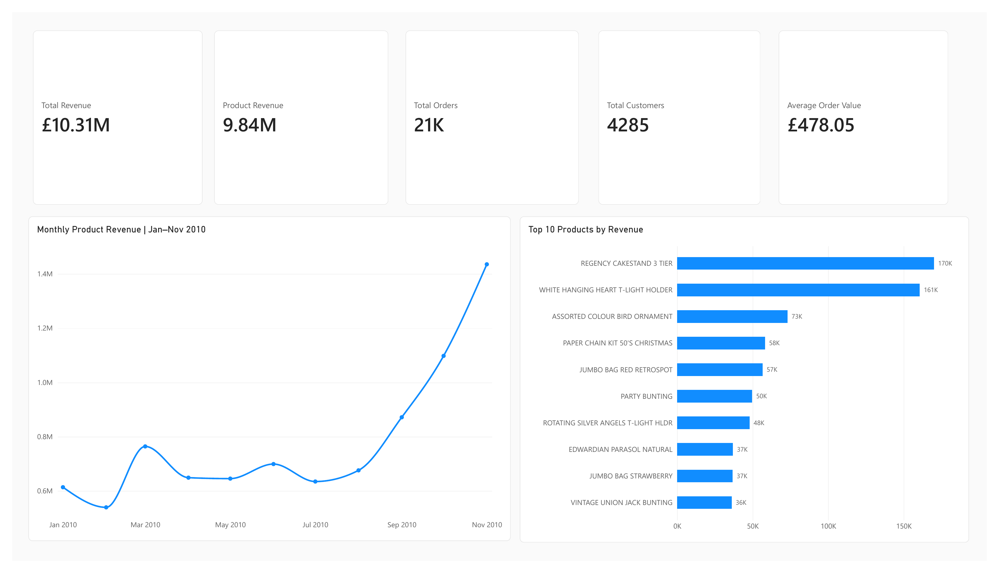
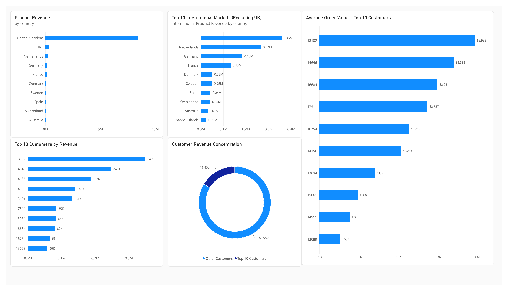

# E-Commerce Analytics Dashboard

**Status: Completed — Final GitHub Review**

An end-to-end e-commerce sales analytics project using Python, Pandas, PostgreSQL, SQL, and Power BI.

## Overview

This project analyzes transaction data from the UCI Online Retail II dataset (2009–2010) to identify sales trends, top-performing products, international markets, and customer purchasing behavior.

The workflow covers data exploration, cleaning, SQL-based analysis, and interactive business intelligence reporting.

## Objectives

- Explore, validate, and prepare transaction data using Python and Pandas.
- Analyze sales performance using SQL and PostgreSQL.
- Identify high-value products, countries, and customers.
- Evaluate customer revenue concentration and average order value.
- Present business insights through a Power BI dashboard.

## Technologies

- **Python:** Pandas, NumPy, Matplotlib
- **Jupyter Notebook:** Data exploration and analysis
- **PostgreSQL / SQL:** Data storage and business queries
- **Power BI:** Interactive dashboards and DAX measures
- **Git / GitHub:** Version control and project documentation

## Dataset

- **Name:** Online Retail II
- **Provider:** UCI Machine Learning Repository
- **Period analyzed:** December 2009 – December 2010
- **Source:** https://archive.ics.uci.edu/dataset/502/online+retail+ii

The original dataset is not included in this repository. Download it from UCI and place it in `data/raw/`.

## Key Findings

| Metric | Result |
|---|---|
| Total transaction records | 511,565 |
| Total revenue | £10.31M |
| Product revenue | £9.84M |
| Identifiable customers | 4,285 |
| Top product | REGENCY CAKESTAND 3 TIER |
| Top international market outside the UK | EIRE |
| Top 10 customers' share of identifiable product revenue | 16.45% |

### Sales Performance

Monthly product revenue increased substantially toward the end of 2010, with November recording approximately £1.44M in product revenue.

### Product Performance

REGENCY CAKESTAND 3 TIER generated approximately £170K in product revenue, making it the highest-revenue product in the analysis.

### Geographic Performance

The United Kingdom accounted for the majority of product revenue. Outside the UK, EIRE, the Netherlands, Germany, and France were among the leading markets.

### Customer Analysis

The ten highest-revenue customers generated approximately £1.43M, representing 16.45% of identifiable customer product revenue.

Customer 18102 generated approximately £349K across 89 product orders, with an average order value of approximately £3,923.

## Power BI Dashboard

The Power BI report contains two pages.

### 1. Executive Overview



Provides an overview of business performance through:

- Total Revenue
- Product Revenue
- Total Orders
- Total Customers
- Average Order Value
- Monthly Product Revenue
- Top 10 Products by Revenue

### 2. Sales & Customer Insights



Explores geographic and customer performance through:

- Product Revenue by Country
- Top 10 International Markets (Excluding UK)
- Top 10 Customers by Revenue
- Customer Revenue Concentration
- Average Order Value — Top 10 Customers

**Power BI file:** `dashboard/Ecommerce_Analytics_Dashboard.pbix`

## Project Structure

```text
ecommerce-analytics-dashboard/
├── dashboard/
│   └── Ecommerce_Analytics_Dashboard.pbix
├── data/
│   ├── raw/
│   └── processed/
├── images/
│   ├── executive_overview.png
│   └── sales_customer_insights.png
├── notebooks/
│   └── 01_data_exploration.ipynb
├── sql/
├── src/
├── .gitignore
├── LICENSE
├── README.md
└── requirements.txt
```

## Getting Started

Clone the repository:

```bash
git clone https://github.com/DrenusheMorina/ecommerce-analytics-dashboard.git
cd ecommerce-analytics-dashboard
```

Create and activate a Python virtual environment on Windows:

```powershell
python -m venv .venv
.venv\Scripts\activate
```

Install dependencies:

```bash
pip install -r requirements.txt
```

Download the original dataset from UCI and place it in `data/raw/`.

Open `notebooks/01_data_exploration.ipynb` to explore the Python analysis.

SQL scripts are available in the `sql/` directory and can be executed against the corresponding PostgreSQL database.

Open `dashboard/Ecommerce_Analytics_Dashboard.pbix` in Power BI Desktop to explore the report.

## Project Workflow

1. Data exploration and quality assessment
2. Transaction classification and revenue analysis
3. Product, country, and customer analysis
4. SQL analysis with PostgreSQL
5. DAX measure development
6. Power BI dashboard creation
7. Documentation and GitHub publication

## Notes and Limitations

- The analysis distinguishes product transactions from non-product transactions.
- Some transactions have missing customer identifiers; customer-level findings use identifiable customers only.
- Duplicate records were assessed but retained because their business meaning could not be conclusively determined.
- December 2010 contains only partial-month data and is excluded from the January–November 2010 monthly trend chart.
- The analyzed dataset does not support a separate cancellation and returns analysis.

## Project Status

- [x] Data exploration and preparation
- [x] Python analysis and visualizations
- [x] PostgreSQL and SQL analysis
- [x] Power BI dashboard
- [x] Key findings documentation
- [ ] Final repository verification
- [ ] GitHub publication
